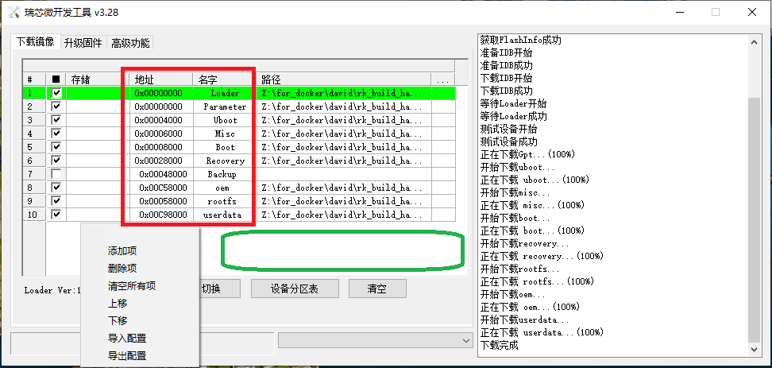
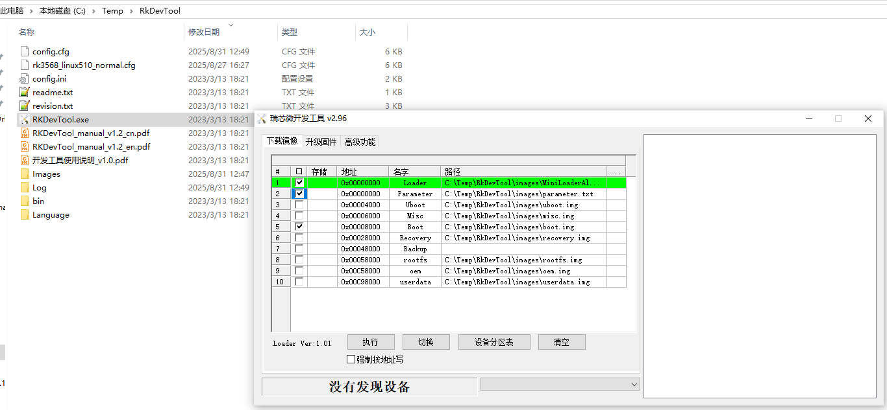

# Build Linux kernel and generate boot.img for Rockchip Linux
## 编译Rockchip的Linux kernel镜像并生成boot.img

### 为什么我要写这篇文章？

1. Rockchip Linux系统对原生Linux系统进行很多的完善优化，比如添加了类似Android构建系统的Lunch菜单，这样可以轻松添加不同的board类型，以便支持不同的开发板和项目，事实上我们目前也正在利用这个特征来支持我司的多个项目。另外，固件的Flash/eMMC镜像分区（采用GPT分区）也采用了类似Android的做法，包括uboot.img, boot.img, rootfs.img, misc.img 和recovery.img等分区文件。其中boot.img是Linux kernel的镜像，但是它不仅仅包含Linux kernel编译出来的Image文件，还包括设备树镜像.dtb文件，以及一些资源文件resource.img。而网络上的Linux编译介绍文章（典型的Linux kernel编译步骤），只会编译输出Linux kernel的镜像文件Image, 并不会生成boot.img文件。

2. Rockchip的Linux SDK，需要找Rockchip原厂申请权限，需要使用repo下载和更新代码，整个SDK包也非常的大，而对于我们dToF sensor应用项目来说，尤其是Ads6401 / Ads6401S应用项目，我们的客户并不需要更新rootfs等镜像，而只需要更新kernel相关的boot.img, 外加少量的Linux 应用文件（这些不需要原厂的SDK支持），所以，我根据网上已有的资源，整理出了一个编译脚本，生成了一个小工具包。


### 下载地址：
[Ads6401_Linux_Driver](https://github.com/David1934/Ads6401_Linux_Driver)
除了小工具包，该git仓库还包括两份驱动发布包。ads6401 和 ads6401s 是两种模组，各用各的 zip，不要混到同一份内核配置里。zip 文件名里的时间戳会变，以仓库里实际文件为准。
```
./ads6401_linux_driver_code_v4.1.0_LM20261009A_20261009122451.zip
./ads6401s_linux_driver_code_v1.2.0_LM20261009A_20261009122327.zip
./Build_boot_image_for_rockchip_Linux.md
./LICENSE
./Linux_Driver_porting_guide_4_ads6401.md
./Linux_Driver_porting_guide_4_ads6401s.md
./README.md
./README_zh_CN.md
./tools/buildtools/build.sh
./tools/buildtools/device/rockchip/common/build.sh
./tools/buildtools/device/rockchip/common/mk-fitimage.sh
./tools/buildtools/device/rockchip/rk3568/boot.its
./tools/buildtools/device/rockchip/rk3568/parameter-buildroot-fit.txt
./tools/buildtools/prebuilts.tgz.part.aa
./tools/buildtools/prebuilts.tgz.part.ab
./tools/buildtools/prebuilts.tgz.part.ac
./tools/buildtools/prebuilts.tgz.part.ad
./tools/buildtools/prebuilts.tgz.part.ae
./tools/buildtools/prebuilts.tgz.part.af
./tools/buildtools/rk3568_linux_510_110_ads6401_for_mini_demo_box.patch
./tools/buildtools/rkbin/tools/mkimage
./tools/DriverAssitant_v5.12.zip
./tools/RkDevTool_2.96.zip
```

### 重要提醒：
   **请在Linux系统下git clone上述Ads6401_Linux_Driver仓库，后续的操作也在Linux系统下进行，因为它们当中包括Windows不支持的符号链接等特征**！
    
### 该工具包的主要功能：

1. 从git hub克隆一个开源的Rockchip Linux kernel源码
1. 按模组选用对应的驱动发布包，集成 ads6401 或 ads6401s 的驱动源码（你也可以在此基础上再按自己的板子改）
1. 编译内核镜像并生成boot.img文件（在rockdev目录下）
1. 清除kernel的编译结果

### 具体步骤：

1. 安装Linux开发环境 (make, git 等)
```
cd ~
sudo apt install -y bc binfmt-support bison bsdmainutils build-essential bzip2 chrpath cmake cpio cpp-aarch64-linux-gnu debianutils device-tree-compiler diffstat expat expect fakeroot fdisk file flex g++ gawk gcc gcc-multilib  g++-multilib gpgv2 iputils-ping libegl1-mesa libelf-dev libgmp-dev libgucharmap-2-90-dev liblz4-tool libmpc-dev libsdl1.2-dev libssl-dev live-build make ncurses-dev net-tools patchelf python2 python3 python-is-python3 python3-jinja2 python3-pexpect python3-pip  socat strace texinfo time tree unzip
```

2. 从github上下载驱动源码及编译工具包
```
cd ~
git clone https://github.com/David1934/Ads6401_Linux_Driver
```

3. 解压编译工具包中的交叉编译工具链
```
cd Ads6401_Linux_Driver/tools/buildtools
cat prebuilts.tgz.part.a* | tar xzvf -
chmod +x rkbin/tools/mkimage
```

4. 下载Rockchip的Linux kernel源码
```
cd Ads6401_Linux_Driver/tools/buildtools
./build.sh clone_kernel
# 将在当前目录下创建kernel目录，存储Rockchip Linux kernel的源码
```

5. 移植dts及驱动源码

   先确认手上的模组，再选 zip。两种不要同时编进一个内核。
   - ADS6401（Spot / Small Flood / Big FoV / Big FoV V2）：`ads6401_linux_driver_code_v4.1.0_LM*.zip`，步骤见 [Linux_Driver_porting_guide_4_ads6401.md](Linux_Driver_porting_guide_4_ads6401.md)
   - ADS6401S（大 FoV Smart，内置 MCU）：`ads6401s_linux_driver_code_v1.2.0_LM*.zip`，步骤见 [Linux_Driver_porting_guide_4_ads6401s.md](Linux_Driver_porting_guide_4_ads6401s.md)

   驱动已经放到 `drivers/media/i2c/ads6401_drv/` 或 `drivers/media/i2c/ads6401s_drv/`，不再是以前 `drivers/media/i2c/` 根目录下的几个 `.c`。模组类型在对应的 `*_build_options.h` 里选。应用层从 `ADAPS_GET_DTOF_MODULE_STATIC_DATA` 读到的 `module_type` 就是这个选择。

   `tools/buildtools/` 里的 `rk3568_linux_510_110_ads6401_for_mini_demo_box.patch` 仍是 ads6401 小型化样机的示例补丁，不能拿去打 ads6401s。

  **驱动程序跟硬件电路紧密相关，我们的驱动发布包仅供参考，客户应在充分理解驱动源码后，根据自己实际的硬件环境进行适当的修改（包括一些编译开关的配置）**

6. 编译和生成boot.img文件
```
cd Ads6401_Linux_Driver/tools/buildtools
./build.sh kernel
# 编译输出的boot.img在kernel目录下
```

7. 烧录boot.img镜像到开发板上
   a. 在PC Windows下，安装Rockchip的usb驱动 （DriverAssitant_v5.12.zip，烧录Rk的固件需要的usb驱动）
   b. 在PC Windows下，解压瑞芯微的开发工具 （以解压到C:\Temp\RkDevTool为例)

   c. 导入开发板eMMC/Flash分区信息 （可由下列步骤导入, "路径"列的各个部件的image实际路径，可根据实际修改！）
 
 在截图的绿色框区域点击鼠标右键，将显示弹出菜单, 选择“导入配置”按钮，选择rk3568_linux510_normal.cfg文件
 
   d. 选择正确的boot.img路径，然后按“执行”按钮开始烧录
   


