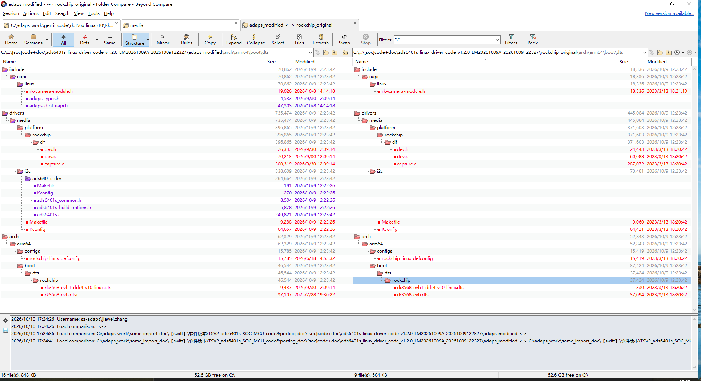

# Linux_Driver_porting_guide_for_ads6401s

本文件只覆盖 ADS6401S，对应发布包 `ads6401s_linux_driver_code_v1.2.0_LM20261009A`（版本号以仓库里实际的 zip 为准）。ADS6401S 是带内置 MCU 的大 FoV Smart 模组，模组类型固定为 `ADS6401_MODULE_BIG_FOV_FLOOD_SMART`（0x6401E）。

Spot、Small Flood、Big FoV、Big FoV V2 仍走 ADS6401 驱动，见 [Linux_Driver_porting_guide_4_ads6401.md](Linux_Driver_porting_guide_4_ads6401.md)。两套驱动不要叠在同一份内核配置里同时打开。

## A. ads6401s驱动porting guide

### 特别提醒

驱动程序跟硬件电路紧密相关，我们的驱动发布包仅供参考，客户应在充分理解驱动源码后，根据自己实际的硬件环境进行适当的修改（包括一些编译开关的配置）。

#### 1. 参考设计的硬件软件环境

- **目标平台**：Rockchip RK3568 SoC
- **内核版本**：Linux 5.10.110
- **SDK包**：基于RK3568的Linux 5.10 SDK
- **样机 I2C**：i2c4，模组 MCU 地址 `0x22`，compatible 字符串 `adaps,ads6401s-mbox`

#### 2. 修改和新增的文件对比


其中`<rockchip_original>`目录是 Rk3568 Linux 5.10 SDK 上原始的源文件，`<adaps_modified>`是我们有修改和新增的文件。

```
kernel/arch/arm64/boot/dts/rockchip/rk3568-evb1-ddr4-v10-linux.dts
kernel/arch/arm64/configs/rockchip_linux_defconfig
kernel/drivers/media/i2c/Kconfig
kernel/drivers/media/i2c/Makefile
kernel/drivers/media/i2c/ads6401s_drv/Kconfig
kernel/drivers/media/i2c/ads6401s_drv/Makefile
kernel/drivers/media/i2c/ads6401s_drv/ads6401s.c
kernel/drivers/media/i2c/ads6401s_drv/ads6401s_build_options.h
kernel/drivers/media/i2c/ads6401s_drv/ads6401s_common.h
kernel/drivers/media/platform/rockchip/cif/capture.c
kernel/drivers/media/platform/rockchip/cif/dev.c
kernel/drivers/media/platform/rockchip/cif/dev.h
kernel/include/uapi/linux/adaps_dtof_uapi.h
kernel/include/uapi/linux/adaps_types.h
kernel/include/uapi/linux/rk-camera-module.h
```

驱动源码在 `drivers/media/i2c/ads6401s_drv/`。`ads6401s_common.h` 是 MCU 寄存器和固件版本位域，要和 `ads6401s.c` 放在同一目录。

#### 3. 移植步骤

##### 3.1 代码集成

1. 将`<adaps_modified>`目录下的文件复制到SDK对应路径：

   - 头文件：`adaps_types.h`、`adaps_dtof_uapi.h`、`rk-camera-module.h` → 复制到`include/uapi/linux/`
   - 驱动目录：`ads6401s_drv/` 整个目录 → 复制到`drivers/media/i2c/`

   发布包里的 `drivers/media/i2c/Kconfig` 和 `Makefile` 是我们整棵内核树上的文件，里面还挂了其它传感器目录。客户这边不要整文件覆盖自己的 Kconfig/Makefile，只把下面两处合进去。设备树、defconfig、CIF 三个文件建议和 `<rockchip_original>` 做一次 diff，再按自己的板子改。
2. 修改I2C驱动Makefile（`drivers/media/i2c/Makefile`）：

   ```makefile
   # 在合适位置添加
   obj-$(CONFIG_VIDEO_ADS6401S) += ads6401s_drv/
   ```

   子目录里的 `ads6401s_drv/Makefile` 已经写了 `obj-$(CONFIG_VIDEO_ADS6401S) += ads6401s.o`，随目录一起拷贝即可。
3. 修改I2C驱动Kconfig（`drivers/media/i2c/Kconfig`）：

   ```Kconfig
   # 在 menu "I2C Encoders, decoders, sensors and other helper chips" 里合适的位置添加
   source "drivers/media/i2c/ads6401s_drv/Kconfig"
   ```

   `ads6401s_drv/Kconfig` 的内容如下。这一版是 `bool`，驱动编进内核。这里没有 `SWIFT_MINI_DEMO_BOX`，那个选项属于 ads6401。

   ```Kconfig
   config VIDEO_ADS6401S
    bool "Enable Adaps ADS6401s sensor support"
    depends on I2C && VIDEO_V4L2
    select V4L2_FWNODE
    help
      This is a Video4Linux2 sensor driver for the Adaps Ads6401s dToF sensor.
   ```
4. 修改 `arch/arm64/configs/rockchip_linux_defconfig`。下面是本次 ads6401s 发布包里需要的选项。发布包自带的 defconfig 末尾还有一行 `CONFIG_SWIFT_MINI_DEMO_BOX=y`，ads6401s 的 Kconfig 里没有这个符号，合配置时不用带上。

   ```
   # 在文件末尾添加
   # adaps modification for swift mini-demo-box on adaps rk3568 SoC mini board
   CONFIG_USB_CONFIGFS_RNDIS=y
   CONFIG_USB_U_ETHER=y
   CONFIG_USB_F_RNDIS=y
   CONFIG_VIDEO_ADS6401S=y
   ```
5. 设备树。我们样机上 ADS6401S 挂在 i2c4，地址是模组 MCU 的 `0x22`，不是 ads6401 那颗 sensor 的 `0x5e`。SoC 这边只看到这一个 I2C 设备，sensor 和片上 EEPROM 都由模组 MCU 转接。compatible 必须是 `adaps,ads6401s-mbox`。

   ```
   &i2c4 {
       status = "okay";
       clock-frequency = <1000000>;

       ads6401s: ads6401s@22 {
           reg = <0x22>;
           status = "okay";
           compatible = "adaps,ads6401s-mbox";
           ...
       };
   };
   ```

   GPIO、时钟、pinctrl 以 `<adaps_modified>` 里的 dts 为准，按客户板子改，不要直接套 ads6401 的节点。
6. 编译开关在 `ads6401s_drv/ads6401s_build_options.h`，不在 `ads6401s.c` 开头。模组类型是写死的，改成别的值会在编译 `config_show()` 时直接 `#error`：

   ```
   #define SWIFT_MODULE_TYPE                               ADS6401_MODULE_BIG_FOV_FLOOD_SMART
   #define ADS6401_MODULE_TYPE_NAME                        "Big_FoV_Flood_Smart"
   ```

   这份发布包默认还打开了这些开关，移植时按自己的硬件核对：

   - `ENABLE_MCU_FIRMWARE_UPGRADE`：允许上层走 misc ioctl 升级模组 MCU 固件
   - `CALIB_DATA_READY_IN_EEPROM_CHIP`：标定数据在模组 EEPROM 里。若改成从文件读，关掉本宏并打开 `CALIB_DATA_FROM_EEPROM_BIN_FILE`
   - `ENABLE_MCU_OUTPUT_FSYNC_TO_SLAVE_ADS6401`：帧同步由模组内置 MCU 输出。注释掉之后，再按文件里的 Option 2 / Option 3 选外部 fsync 或 sensor 自己做 master
   - `MINI_DEMO_BOX`：当前直接 `#define` 了，注释写明 ads6401s demo 只在 demo4 小盒子上跑。客户自己的板子如果电源和 GPIO 不一样，先看这个宏下面包了哪些代码再决定去留
   - `MIPI_SPEED` 默认 `MIPISPEED_1G5_BPS`（1.5Gbps），`SENSOR_DATA_LANE_COUNT` 为 2

##### 3.2 编译与部署

1. 典型的内核编译步骤：

   ```bash
   make ARCH=arm64 rockchip_linux_defconfig
   make ARCH=arm64 -j8
   ```
2. Rockchip 公司对内核进行了一些类似 Android 化的定制修改，可支持 adb，kernel 的烧录镜像文件使用 boot.img。具体步骤见[编译Rockchip的Linux kernel镜像并生成boot.img](Build_boot_image_for_rockchip_Linux.md)。客户应根据实际使用的平台做相应处理。

#### 4. 验证

这一版 Kconfig 是 `bool`，驱动编进内核，`lsmod` 里看不到 `ads6401s`。

- 检查驱动加载：`dmesg | grep "<DRV_ADS6401S>"`。probe 成功时会打出 `ads6401_module_type: Big_FoV_Flood_Smart` 和 `driver_version: 1.2.0_LM20261009A`
- 确认设备节点：`ls /dev/ads6401_misc`。节点名故意和 ads6401 保持一致，上层应用不用改打开的路径
- 确认 sysfs。下面是我们样机 i2c4、地址 0x22 上的路径，总线号以自己的 dts 为准：
  ```bash
  root@rk356x:~# cat /sys/devices/platform/fe5d0000.i2c/i2c-4/4-0022/info
  Adaps ads6401 dToF sensor driver
  Version:                       1.2.0_LM20261009A
  Matched Compatible string:     adaps,ads6401s-mbox
  Last Build Time:               2026-10-09 12:23:27
  I2C Bus Num:                   4
  I2C bus configured frequency:  1000000 Hz
  I2C address for ads6401:       0x22
  Current TTY:                   pts0
  tdc_delay_major:               0xa
  tdc_delay_minor:               0x8

  root@rk356x:~# cat /sys/devices/platform/fe5d0000.i2c/i2c-4/4-0022/config
  Build switch options:
  ---------------------------------------------------------
  MINI_DEMO_BOX:                                     Yes
  ADS6401_MODULE_TYPE:                               Big_FoV_Flood_Smart
  ENABLE_MCU_OUTPUT_FSYNC_TO_SLAVE_ADS6401:          Yes
  ENABLE_EXTERNAL_FSYNC_SIGNAL_TO_SLAVE_ADS6401:     No
  ENABLE_MCU_ERROR_IRQ:                              Yes
  ENABLE_MCU_FIRMWARE_UPGRADE:                       Yes
  CALIB_DATA_READY_IN_EEPROM_CHIP:                   Yes
  CALIB_DATA_FROM_EEPROM_BIN_FILE:                   No
  ...
  NON_CONTINUOUS_MIPI_CLK:                           Yes
  MIPI_DATA_LANE_COUNT:                              2
  MIPI_SPEED:                                        1500 Mbps
  SOC_MIPI_RX_CLOCK_FREQ:                            750 MHz
  EEPROM_CHIP_CAPACITY:                              65536 bytes
  ADAPS_DBG_ONCE:                                    0x2000000
  ```

  `info` 第一行的驱动名字符串目前仍写成 ads6401，用 Version、`adaps,ads6401s-mbox` 和 `ADS6401_MODULE_TYPE: Big_FoV_Flood_Smart` 区分。`Last Build Time` 是编译内核的时间。`status` 里除了 `Ads6401 module type: 6401E`，还有模组 MCU 的 Firmware type / version。

## B. ads6401s驱动里和 ads6401 不一样的地方

v4l2 的 `s_power` / `s_stream` / `set_fmt` / `sensor_ioctl`，以及 misc 设备那套 `ADAPS_GET_DTOF_MODULE_STATIC_DATA`、寄存器读写，骨架和 ads6401 相同，这里不重复贴。EEPROM v2 的布局（`swift_eeprom_v2_data_t`）也和 ads6401 大 FoV 模组同一份头文件，见 ads6401 移植指南 B.3。下面只写 ads6401s 多出来、或者用法不一样的部分。

#### 1. module_type

`adaps_types.h`：

```c
// TS Smart module with built-in MCU
#define ADS6401_MODULE_BIG_FOV_FLOOD_SMART  0x6401E
```

`get_module_type()` 固定返回 `SWIFT_MODULE_TYPE`，也就是 `0x6401E`。应用层从 `ADAPS_GET_DTOF_MODULE_STATIC_DATA` 读到的 `module_type` 就是这个值，用来和 ads6401 的 Spot / Flood / Big FoV / Big FoV V2 区分开，再决定怎么解析 mmap 里的标定数据。`adaps_dtof_update_eeprom_data` 里也有同名字段，本发布包的驱动没有开放更新 EEPROM 的 ioctl。

`adaps_dtof_uapi.h` 里相关字段：

```c
struct adaps_dtof_module_static_data{
    __u32 module_type;            // refer to ADS6401_MODULE_SPOT/ADS6401_MODULE_SMALL_FLOOD/... of adaps_types.h file
    __u32 eeprom_capacity;       // unit is byte
    __u16 otp_vbe25;
    __u16 otp_vbd;        // unit is 10mv, or the related V X 100
    __u16 otp_adc_vref;
    __u8 chip_product_id[SWIFT_PRODUCT_ID_SIZE];
    __u8 sensor_drv_version[FW_VERSION_LENGTH];
    __u8 ready;
    __u8 eeprom_crc_matched;
};

struct adaps_dtof_update_eeprom_data{
    __u32 module_type;            // refer to ADS6401_MODULE_SPOT/ADS6401_MODULE_SMALL_FLOOD/... of adaps_types.h file
    __u32 eeprom_capacity;       // unit is byte
    __u32 offset;             //eeprom data start offset
    __u32 length;                //eeprom data length
};
```

#### 2. SoC 上的 I2C 设备


| 名称     | i2c地址 | 注册方式                     | 作用                                                               | 备注                              |
| -------- | ------- | ---------------------------- | ------------------------------------------------------------------ | --------------------------------- |
| 模组 MCU | 0x22    | i2c_add_driver()，dts 里声明 | SoC 唯一直接访问的设备。sensor 寄存器、EEPROM、VCSEL 都经 MCU 转发 | compatible =`adaps,ads6401s-mbox` |

ads6401 那张表里的 sensor 0x5e、eeprom 0x50/0x51、vcsel 0x31、dvcc 0x45，在 ads6401s 上都不挂 SoC 的 I2C 总线。

#### 3. 模组 MCU 固件相关 ioctl

定义在 `adaps_dtof_uapi.h`，由 `/dev/ads6401_misc` 处理。需要 `ads6401s_build_options.h` 里打开 `ENABLE_MCU_FIRMWARE_UPGRADE`。固件版本的位域在 `ads6401s_common.h` 的 `mcu_fw_version_t`：低 8 位 revision，接着 4 位 minor，最高 4 位 major。


| ioctl                                                       | 作用                                     |
| ----------------------------------------------------------- | ---------------------------------------- |
| ADTOF_GET_MCU_RUNNING_FW_TYPE                               | 读当前跑的是 bootloader 还是 application |
| ADTOF_GET_MCUFIRMWARE_VERSION                               | 读当前固件版本，16bit，按上面的位域拆    |
| ADTOF_LET_MCU_ENTER_BOOTLOADER                              | 让 MCU 进入 bootloader，之后才能写固件   |
| ADTOF_SET_MCU_FW_LENGTH / ADTOF_SET_MCU_FW_CRC32            | 下发固件长度和 CRC32                     |
| ADTOF_GET_BLOCK_SIZE_4_FLASH_WRITE                          | 每次写 flash 的块大小                    |
| ADTOF_TRANSFER_DATA_WITH_OFFSET                             | 按偏移把固件数据送进驱动的 mmap buffer   |
| ADTOF_GET_FLASH_WRITE_STATUS / ADTOF_SET_FLASH_WRITE_STATUS | 查询 / 推进 flash 写入状态               |
| ADTOF_GET_MCU_FW_UPGRADE_STATUS                             | 查询升级结果                             |
| ADTOF_LET_MCU_REBOOT                                        | 升级结束后让 MCU 重启                    |

bootloader v1.0.0 上有已知的稳定性问题。升级前先读 `ADTOF_GET_MCUFIRMWARE_VERSION`，确认当前 bootloader 版本。
